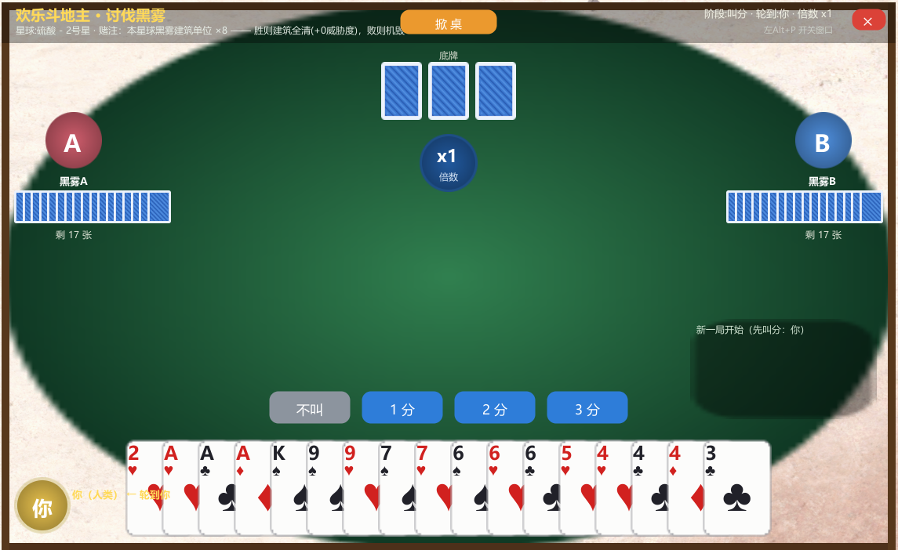

# DSPDouDizhu —— 斗地主讨伐黑雾 🃏⚔️🛰️

> **模组作者：妙妙在路上 · 抖音@妙妙在路上**

一个《戴森球计划》BepInEx 娱乐模组：把"清剿黑雾"变成一场斗地主对局。

> **English**: A Dyson Sphere Program BepInEx mod — settle your war against the Dark Fog over a game of Dou Dizhu (Fight the Landlord). Press `LeftAlt+P` on any infested planet. **Win** = every Dark Fog BUILDING on that planet is wiped out (units & relays spared) with **ZERO space threat gain**. **Lose** = your Icarus is destroyed (mission failed), your buildings are untouched. 'Flip Table' = enrage all hives & ground bases to 100% threat.

---

## 🎮 玩法说明

1. **前提**：战斗模式存档（有黑雾），且已降落到一个**有黑雾建筑**的星球。
2. 按 **`左Alt+P`** 打开斗地主牌桌（**不暂停游戏**——黑雾仍会照常行动，打牌时留意别挨打）。
3. 标准斗地主规则：**叫分定庄（1/2/3分）→ 54 张牌 → 地主拿 3 张底牌 → 先出完者胜**。
   - 支持牌型：单张 / 对子 / 三张 / 三带一 / 三带二 / 顺子 / 连对 / 飞机（含带单翅、带对翅）/ 四带二单 / 四带二对 / 炸弹 / 王炸
   - 炸弹与王炸使倍数 ×2；春天 / 反春天再 ×2
4. 与两名 AI 对局。你的身份（地主/农民）由叫分决定：
   - 你是**地主**：你先出完 → 胜；任一农民先出完 → 败
   - 你是**农民**：你或队友先出完 → 胜；地主先出完 → 败

### 🃏 掀桌（顶部中央橙色按钮）

牌桌**顶栏中央**有一个橙色【掀 桌】按钮：



点击后会弹出确认框 **【确定掀桌？后果自负！】**：

- 确认【掀了！】→ **当前星球全部地面黑雾基地 + 全部太空黑雾巢穴的威胁度立刻拉满 100%**，并进入集结状态
- 后果：黑雾会以最高强度连续组织进攻波次（地面强袭 + 蜂巢派兵），打得过就打，打不过**赶紧跑路**
- 这是玩家主动触发的同归于尽按钮，不受"威胁度守卫"保护——守卫只在胜利清建筑时保证太空威胁度 +0
- 担心打不过？点【算了】冷静一下，牌还能接着打

## ⚖️ 赌注（与当前星球黑雾建筑关联）

| 结果 | 效果 |
| --- | --- |
| 🏆 **胜利** | **当前星球黑雾建筑全部清除**（基地/激光塔/等离子塔/护盾/连接轨道/复制器），走官方击杀路径（爆炸特效、掉落战利品）。**地面小兵与中继站保留** |
| ☠️ **失败** | **玩家机甲摧毁（任务失败）**，进入正常死亡/重生流程；**玩家建筑全部保留** |

### 🔒 太空威胁度保护（核心机制）

模组通过「威胁度快照守卫」保证胜利全灭后：

- 全体黑雾蜂巢的 `EvolveData`（**太空威胁度 threat** / 进化经验 / 等级 / 波次计数）在执行前整结构体快照；
- 当前星球全部黑雾地面基地的 `EvolveData`（地面威胁度）同样快照；
- 全灭执行后立即回写，并在可配置窗口期（默认 25 秒）内每帧回写，压制官方击杀链路（含延迟执行的 `ReclaimThreatCarry`、`ExecuteDeferredEnemyChange` 等）可能产生的任何威胁/经验增长；
- 蜂巢的 `relayNeutralizedCounter` 一并还原。

结果：**黑雾建筑全灭，太空黑雾威胁度 +0**，进化等级/经验不涨，不会因此招来更猛烈的全球报复。

## ⌨️ 快捷键与操作

| 操作 | 说明 |
| --- | --- |
| `左Alt+P` | 打开 / 关闭斗地主窗口（仅限有黑雾建筑、工厂已加载的星球；否则弹出提示） |
| 顶栏【掀桌】 | 弹出确认【确定掀桌？后果自负！】，确认后**当前星球全部地面黑雾基地 + 全部太空黑雾巢穴威胁度立刻拉满 100%** 并进入集结报复状态（警告：它们会疯狂进攻） |
| 点击手牌 | 选牌 / 取消（可多选，亮起表示将打出） |
| `💡 提示` | 自动选出一手能压住的最小组合（自由出牌时推荐较小组合） |
| `不出` | 仅在跟牌时可用 |
| `出牌` | 打出选中的牌（牌型不合法或压不上会有提示） |

- 窗口打开期间**不暂停游戏**；模组已屏蔽点击穿透（Harmony 补丁强制 `VFInput.onGUI/onGUIOperate/inputing`，并插入全屏透明 UGUI 遮挡板拦截身后 HUD 点击）——点牌不会误触游戏世界与 HUD，WASD/滚轮/ESC 也不会穿透，关闭窗口即恢复。
- 失败后会显示**机甲解体倒计时**（默认 5 秒），可点「立即受死」提前执行；到点自动关闭窗口并触发玩家死亡。

## ⚙️ 配置（BepInEx 配置文件 `BepInEx/config/com.deepseekwork.dspdoudizhu.cfg`）

| 配置项 | 默认 | 说明 |
| --- | --- | --- |
| `General.AiThinkSeconds` | 0.9 | AI 每步思考延迟（秒，0.1~3） |
| `General.ThreatGuardSeconds` | 25 | 胜利后威胁度守卫持续秒数（5~120） |
| `General.DeathCountdownSeconds` | 5 | 失败后死亡倒计时（秒，1~15） |

## 📦 安装

**方式 A（r2modman / Thunderstore）**：在管理器中搜索安装 `DSPDouDizhu`，或手动导入 `dist/DSPDouDizhu-<版本>.zip`。

**方式 B（手动）**：
1. 安装 [BepInEx 5.4.x](https://dsp.thunderstore.io/package/xiaoye97/BepInEx/)；
2. 将 `DSPDouDizhu.dll` 放入 `BepInEx/plugins/DouDizhuMod/`；
3. 启动游戏。

## 🔨 从源码构建

```powershell
powershell -ExecutionPolicy Bypass -File build.ps1            # 编译 + 打包 dist zip
powershell -ExecutionPolicy Bypass -File build.ps1 -Deploy    # 另外部署到游戏 BepInEx\plugins\DouDizhuMod
```

- 离线构建：直接引用本机游戏 `DSPGAME_Data/Managed` 的程序集与 BepInEx 核心，用 .NET SDK 自带 Roslyn csc 编译（`-langversion:7.3`），无需联网与 NuGet。
- 斗地主引擎为纯 C#（无 Unity 依赖），位于 `src/Engine/`，可用 `tests/EngineTest` 单独自测：`dotnet run --project tests/EngineTest -c Release`。

## 🧩 实现说明

- **地面黑雾识别**：遍历 `PlanetFactory.enemyPool`（`EnemyData.id == 索引` 过滤有效项），统计与清除只针对**当前星球的建筑类实体**（跳过 `dynamic/unitId>0` 的地面小兵）；太空蜂巢与航行中的中继站不受影响（掀桌功能除外，见下）。
- **清除路径**：`PlanetFactory.KillEnemyFinally(id, ref CombatStat.empty)` —— 与游戏内黑雾建筑被激光打爆完全相同的官方链路（爆炸特效、掉落、警告广播、引用清理、遗迹坑位处理）。清除顺序：非基地建筑 → 基地，规避连锁清理干扰。
- **掀桌**：当前星球全部地面基地 + 全部太空蜂巢 `EvolveData.threat/threatshr` 直接拉满 `maxThreat`（100%）并触发 `UnderAttack()` 集结报复；玩家主动触发，不走威胁度守卫。
- **无击杀者归因**：传入空的 `CombatStat`，不计入机甲战斗统计，避免刷战斗经验。
- **玩家死亡**：`Player.Kill()` 官方完整流程（机甲爆炸音频、任务失败通知、重生流程）；不修改 `PlanetFactory`，玩家建筑零影响。
- **黑雾会重建**：全灭只清除当前实体。黑雾势力后续仍可能重新扩张/降落新的基地（这是原版机制）；届时可再开一局。

## ⚠️ 注意事项

- 本模组为娱乐性质：全灭整颗星球黑雾的掉落物较多，注意垃圾清理系统负载。
- 未针对 Nebula 多人联机测试；联机时请勿使用（状态为单端修改）。
- 成就系统：模组操作可能使部分战斗相关成就无法在本次对局中正常解锁。

## 📜 许可

MIT
